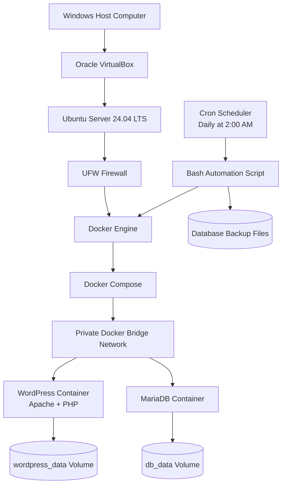

# CCM101 - Enterprise Cloud Architect
## System Architecture Diagram

## Architecture Description

The Windows host runs Oracle VirtualBox, which provides the Ubuntu Server virtual machine.

Ubuntu Server runs Docker Engine and Docker Compose. WordPress and MariaDB operate as separate containers connected through a private Docker bridge network.

WordPress uses MariaDB to store website data. Docker volumes provide persistent storage for application files and database records.

The UFW firewall protects the Ubuntu server. The Bash automation script manages Docker services and creates database backups. Cron automatically executes the backup script every day at 2:00 AM Philippine time.
